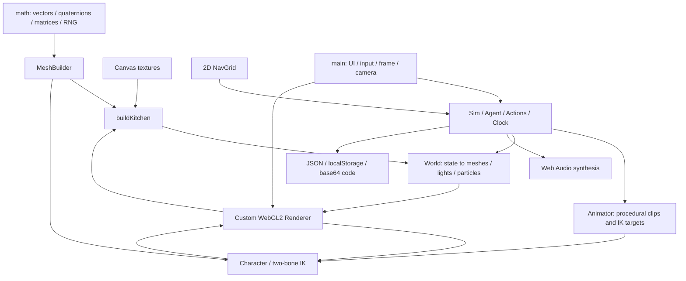

# Architecture and complete interaction trace

Source path for all line references: `/workspace/audit/source/naomis-kitchen.html`.

## Observed dependency structure



Startup is synchronous after the window load event plus a 30 ms timer (`:3219`). It constructs the renderer, generates textures and room geometry, builds Naomi, bakes a nav grid, creates one agent and binds DOM handlers (`:3001–3043`). There is no separate asset loading manager or build step. Normal mode starts RAF behind the start overlay; test mode requires explicit frames/soaks.

## Cooking: traced from decision to persistence

1. `Sim.updateAgent` decays needs (`:2643`), calls `choose` if no action (`:2656`). Scores are hunger urgency², meal-window bonus, personality weights, cooldowns and top-three weighted randomness (`:2460`). Selection has autonomy at **action boundaries**, not at each movement or cooking decision.
2. `Sim.start` creates a fixed list of `wash → fridge → prep → stove → serve → carry → sit → eat → dishes` steps (`:2478`, `:2248`). The recipe depends on clock at construction. This is a scripted task selected by utility AI, not an emergent recipe planner.
3. `beginStep(goto)` requests A* to the hardcoded `SP` position (`:2521`). The 102×60 grid uses 8-way neighbors, rejects corner cuts, then string-pulls (`:2100`). `move` accelerates, turns and brakes toward waypoints (`:2704`). There are no floor IDs, height edges, body sweeps or reservations.
4. `frame` updates the Animator with simulation dt (`:3188`). Walk phase uses distance/speed; the idle/walk/seated poses blend; `stepIK` supplies world-space anchors, procedural chop/stir/scrub loops and head look (`:2589`, `:2614`). `Character.apply` produces skin matrices; `_ik` solves arms (`:1420`, `:1445`). Shader skinning blends two matrices per vertex (`:416`).
5. Action callbacks change object state: fridge target, knife and plate attachment strings, pot progress/portions, faucet, burner, dirt and needs (`:2253–2302`). `World.sync` transforms the fridge door, chair and water mesh, attaches props to the first agent's bones, changes food visibility and room lighting, emits particles (`:2797`). There is no contact confirmation before state changes: the timer ends whether or not the hand reached the anchor.
6. Audio events come directly from action start/end or chop timer comparisons (`:2687`), while continuous water/sizzle/kettle loops follow object state in `Audio.sync` (`:2977`). Footsteps follow walk phase in `frame` (`:3190`). No recorded Foley, spatial mixer, voice conversation or event bus.
7. Eating directly increases hunger satisfaction and reduces plate food (`:2299`); the action's `done` callback adds a fixed-text memory/moodlet (`:2276`). Memories are capped at forty (`:2201`); they do not influence choice.
8. `serialize` writes object/agent/clock data (`:2741`); localStorage is saved by menu or every 60 accumulated loop seconds (`:3206`). Imported codes are base64 JSON. `load` reconstructs action arrays from current state and restarts the indexed step (`:2749–2766`). It omits RNG state and elapsed step time and can change the action's meaning.

## Disconnections

| Link | Actual state |
|---|---|
| AI → hygiene recovery | Absent: need decays, no standalone wash/bath selection |
| Bedtime → bedroom/stairs | Absent: corridor disappearance and numerical sleep |
| Relationship → another actor | Absent: only local values, phone recipient bug |
| Chair transform → nav obstacle | Absent: static dynamic-API record never updated |
| Cooking → physical heat/ingredients | Approximate: progress driven by action fraction; no inventory or heating requirement for completion |
| Object dirt/liquid amount → material | Mostly absent: crumbs appear, but plate/cup don't visibly encode their dirty/liquid state |
| Animation contact → object mutation | Absent: fixed timer callbacks, no validated contact event |
| Save → exact continuation | Broken: array reconstruction, missing elapsed/RNG state, non-atomic parse application |
| UI → household interaction | Observe/camera/save only; no picking or direct object commands implemented |

## Recommended replacement boundaries

Keep a renderer-independent **fixed-tick simulation core**: Clock, needs data, personality parameters, utility formula experiments and semantic action intentions. Adapt existing kitchen steps as migration fixtures, not immutable production code. Replace embedded coordinates with IDs resolved from GLB extras/sidecar manifests.

Proposed contracts:

```text
ObjectDefinition: id, roomId, floorId, affordances, anchors, collider, stateSchema
Affordance: preconditions, reservations, approachAnchor, clipSet, contactEvents,
            effects, cancelPolicy, privacyPolicy, durationDistribution
TaskInstance: id, actorIds, objectIds, phaseId, elapsedTicks, recipeId,
              reservations, carriedItemIds, eventJournal
PresentationEvent: taskId, actorId, eventId, scheduledTick, contactAnchor
SaveV2: schemaVersion, assetVersion, tick, RNG streams, entities,
        tasks, reservations, scheduledEvents
```

Use acquire → approach → align → enter → loop → exit → release phases. Animation events acknowledge item transfer and switches; a timeout invokes explicit rollback/settling policies. Object state is authoritative, visuals are projections. An off-camera room still runs its agents at reduced decision frequency; it is not replaced by an `away` flag. Separate simulation, visual variation and audio RNG streams.

Single-floor grid navigation can remain a test oracle for the kitchen. For the full house, a room/floor portal graph should connect local navigation meshes, doors and reserved stair links. Stair movement uses the actual authored stair profile and authored stair gait plus foot correction. Do not turn the current 2D path into an elevator teleport.

Migration order: lock source/evidence → define asset/action/save contracts → prove GLB room and Naomi → swap rendering adapter → port one full interaction chain → implement floors/reservations → add family. Cross-check outcomes against these logs while accepting that visual animation assets will be replaced.
